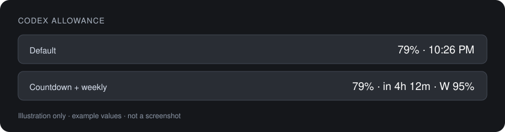

# Codex Allowance

A native macOS menu-bar utility that keeps your Codex allowance and reset time visible while you work.

**Swift · AppKit · macOS 13+ · no third-party Swift dependencies**



The default display is `79% · 10:26 PM`: five-hour allowance remaining, followed by its reset time in your Mac's local time. Values in examples are illustrative.

## Features

- Five-hour percentage and reset time, always in the menu bar.
- Weekly allowance and both reset dates in the dropdown.
- Optional weekly percentage in the menu-bar text.
- Optional countdown instead of the reset clock time.
- Refresh every five minutes, after wake, or on demand.
- Last successful update time and readable connection errors.
- Optional notifications at 20% and 10% remaining, with history saved across restarts.
- Optional launch at login through macOS Service Management.
- Preferences saved using UserDefaults.

Notifications and login startup start off. Enable them from the app's menu. macOS controls notification permission and may require approval for a login item. The five-hour alert is based on observed readings: if the first reading is 8%, it sends one low-allowance notification, not two. Alerts are not sent while the app is closed.

## Run

Build the app using the instructions below, then open **Codex Allowance.app**. It has no Dock icon or main window; click its menu-bar text for controls. To reposition it, use the normal macOS menu-bar arrangement controls. A crowded or automatically hidden macOS menu bar can still hide the item.

Requires macOS 13 or later, ChatGPT or Codex installed in Applications, and an existing signed-in account accessible to the bundled Codex CLI. This is an independent utility, not an official OpenAI product.

## Build and test

Install Xcode or the appropriate Apple developer tools with Swift 5.9 or newer. There are no third-party Swift package dependencies.

```bash
git clone https://github.com/dana-engels/codex-allowance.git
cd codex-allowance
./scripts/test.sh
./scripts/build.sh
open "dist/Codex Allowance.app"
```

Open `Package.swift` in Xcode to browse the package. The packaging script creates the menu-bar app bundle and signs it locally. For a command-line live-data check:

```bash
"dist/Codex Allowance.app/Contents/MacOS/CodexAllowance" --check
```

`BUILD_DIR` and `APP_OUTPUT` can override the build directory and packaged-app path. The default build directory is `.build` and the default app is in `dist/`.

## Why this project

Checking a usage counter should not require leaving the active window and opening an account menu. This project puts a compact reading in the menu bar, with optional alerts when the five-hour allowance gets low. It is a native desktop utility focused on visibility, predictable refreshes, and clear failure handling.

## How it works

```text
Bundled Codex CLI
        |
        | newline-delimited JSON through stdin/stdout
        v
UsageClient -> UsageDecoder -> UsageSnapshot
                                  |
                       +----------+----------+
                       v                     v
                  menu-bar display      alert policy
                                             |
                                      macOS notifications
```

`UsageClient` starts the CLI's `app-server`, initializes the connection, and requests `account/rateLimits/read`. It does not send model prompts. It uses the CLI's existing sign-in rather than reading or copying credentials itself.

`UsageDecoder` selects the `codex` bucket and finds windows by their duration: 300 minutes for five-hour usage and 10,080 minutes for weekly usage. It computes `100 − usedPercent`, rounding down for the integer display. A weekly window can never silently stand in for a missing five-hour window.

The UI runs on the main thread. Requests run on a background queue, one at a time. Requests have a 20-second timeout and a 1 MB response limit. A short local timer updates countdown text and hides expired data; it does not make extra network requests. Readings older than six minutes are no longer shown as current.

## Source map

| File | Responsibility |
| --- | --- |
| `Sources/AllowanceCore/Usage.swift` | Data types and response validation |
| `Sources/AllowanceCore/UsageDisplay.swift` | Percentage and reset-time formatting |
| `Sources/AllowanceCore/AlertPolicy.swift` | Threshold decisions and window identity |
| `Sources/UsageService/UsageClient.swift` | CLI discovery, pipes, JSON handshake, timeout, cleanup |
| `Sources/CodexAllowance/AppDelegate.swift` | Refresh coordination and menu-bar controls |
| `Sources/CodexAllowance/Preferences.swift` | Saved display and notification choices |
| `Sources/CodexAllowance/NotificationManager.swift` | macOS permission, notification delivery, deduplication |
| `Sources/CodexAllowance/LoginManager.swift` | Native login-item registration |
| `Sources/CodexAllowance/main.swift` | App entry point and live-data check |

## Documentation

- [Project overview and design decisions](docs/PROJECT_OVERVIEW.md)
- [Code walkthrough](docs/CODE_WALKTHROUGH.md)
- [Testing and manual acceptance checklist](docs/TESTING.md)
- [Troubleshooting](docs/TROUBLESHOOTING.md)
- [Portfolio project summary](docs/PORTFOLIO_NOTES.md)
- [Changelog](CHANGELOG.md)
- [Contributing](CONTRIBUTING.md)

## Privacy and limitations

There is no custom analytics, external server, or API key in this project. The bundled Codex process performs the account-usage request using its existing configuration. The app saves local preferences and a small alert history containing account identifiers, reset times, and sent thresholds. It does not save conversation text or account credentials.

The bundled CLI path and protocol can change after an app update. An expired sign-in or a different CLI account can also interrupt readings or make them differ from the desktop UI. This is not a supported public quota API. The display is a periodically refreshed indicator, not a billing authority or a real-time counter.

This local app is ad-hoc signed, not notarized for public distribution. Notification delivery depends on macOS permissions, Focus settings, and notification preferences. Login registration is implemented through SMAppService; a local build may require approval or manual addition in System Settings. Public distribution would need a proper signing/notarization workflow and testing on other Macs.

## Validation

20 automated XCTest tests cover response validation, correct window selection, expired and malformed data, countdown formatting, alert thresholds/history, and a simulated CLI server (handshake, partial replies, closed connections, RPC errors, and timeout). The tests use synthetic data and do not require a real account. They do not grant macOS permissions or verify actual notification banners or login after a reboot.

## Remove

Turn off **Launch at Login** in the app, quit it, and delete the app. If macOS still lists it, remove it under System Settings → General → Login Items. Local preferences use the domain `local.dana.codex-allowance`.

## Project status and license

Version 2.0 is a locally verified source project, not a notarized public app release. See the [test notes](docs/TESTING.md) for verification scope and remaining manual checks.

Created by **Dana Engels**. No license has been selected; this repository does not include a license file.
